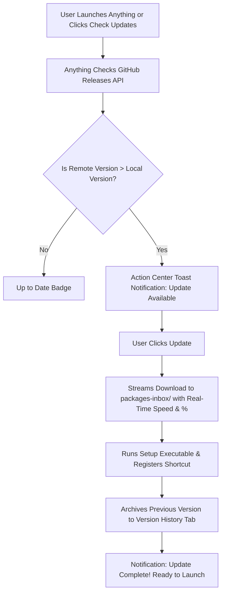

# 🚀 Anything Ecosystem: Auto-Update, GitHub Sync & Child App Lifecycle Guide

**Architect & Creator**: Burhanuddin Sounasath  
**Version**: 2.0 (Windows 11 / Liquid Glass Architecture)  
**Applicable For**: Anything Parent App & All Child Applications (e.g. MediaFlow Studio)

---

## 📌 Executive Summary

The **Anything** ecosystem features an automated, zero-server auto-update and child application distribution engine powered directly by **GitHub Releases** and local JSON registries.

Developers and creators do not need custom backend update servers or complex database configurations. Simply:
1. Paste the GitHub repository link into `app-sources.json`.
2. Push your builds to GitHub Releases using our automated script (`npm run release:github`).
3. Anything automatically discovers, lists, downloads, installs, updates, and synchronizes the child app with live Liquid Glass splash screen loaders in real time!

---

## 📂 1. The Zero-Touch Registry: `app-sources.json`

Instead of manually editing manifests, you only need to add your app's GitHub repository or release URL into **`app-sources.json`** located in the root of the Anything workspace:

```json
[
  {
    "url": "https://github.com/BSFrameWorks5253/MediaFlow-Studio",
    "name": "MediaFlow Studio",
    "category": "Media & Video",
    "autoSync": true
  },
  "https://github.com/BSFrameWorks5253/AnotherCreativeTool"
]
```

### How Anything Automates This:
- **Live File Watcher**: Anything actively watches `app-sources.json`. The moment you save the file, Anything detects the new link without restarting.
- **GitHub API Query**: Automatically contacts `https://api.github.com/repos/:owner/:repo/releases/latest`.
- **Auto-Generates Files**:
  - Creates `releases/<app-id>/v<version>/app.json` with identity, category, and styling.
  - Creates `releases/<app-id>/v<version>/release.json` with features and changelogs extracted from the release notes.
  - Creates `releases/<app-id>/loader-config.json` with default Apple Ambient Liquid Glass parameters.
- **Immediate Catalog Listing**: The child app immediately appears on the Anything Apps Page with glass cards, search, and one-click download.

---

## 🛠️ 2. What Must Be Done in the Child App

To make any new child app seamlessly integrate and auto-update through Anything, follow these 3 simple conventions:

### A. Binary Naming Standard
When building the app's Windows installer/executable, name the release asset:
- Setup Installer: `<AppName>_<version>_Setup.exe` (e.g. `Mediaflow_studio_6.0.0_Setup.exe` or `PhotoStudio_1.2.0_Setup.exe`)
- Standalone Binary: `<AppName>_<version>.exe` (e.g. `Mediaflow_studio_6.0.0.exe`)

### B. GitHub Release Tagging
Create releases using standard semantic tags:
- `v1.0.0`, `v1.0.1`, `v6.0.0`, etc.
- Attach the setup executable to the release assets.

### C. (Optional) Synchronized Splash Loader
When Anything launches your child app, it passes a command-line argument pointing to the live synchronized loader config:
```bash
YourApp.exe --loader-config="C:\Users\<user>\AppData\Roaming\Anything\loaders\<app-id>.json"
```

In your child app, you can read this JSON file on startup to render a splash screen that matches the exact visual theme, monogram, colors, and boot phrases configured in Anything!

---

## ⚡ 3. Automated Version-Wise Build & Release Publishing

To push your setup executable to GitHub Releases version-wise automatically after every build, use the built-in publishing engine:

### Option A: Set Your GitHub Personal Access Token (One-time)
Create a Personal Access Token with the `repo` scope on GitHub, then:
```powershell
# Set token for your current terminal session:
$env:GH_TOKEN="ghp_yourPersonalAccessTokenHere"

# Or save it in a .env file in the Anything root folder:
GH_TOKEN=ghp_yourPersonalAccessTokenHere
```

### Option B: Run the Release Script
```powershell
# 1. Publish Anything Setup Executable to GitHub Releases:
npm run release:github

# 2. Publish a specific Child App (e.g. MediaFlow Studio):
node scripts/publish-github-release.cjs --app=mediaflow-studio

# 3. Publish Everything (Anything and all Child Apps):
npm run release:all
```

### What the Script Automatically Performs:
1. Reads `package.json` or `releases/<appId>/v<version>/app.json` to extract version, product name, and GitHub repo.
2. Locates the built setup executable (`Mediaflow_studio_<version>_Setup.exe` or `Anything_<version>.exe`).
3. Checks if the release tag (`v<version>`) already exists on GitHub.
4. Generates formatted markdown release notes with highlights, features, improvements, and fixes.
5. Uploads the setup executable asset to GitHub Releases.
6. Returns the live release URL and direct download link.

---

## 🔄 4. How Auto-Update Operates on the User's PC



### Key Advantages:
1. **Delta Blockmap & Direct Setup Support**: Works with standard NSIS Setup executables, MSIX, and ZIP packages.
2. **Action Center Notifications**: Windows 11 native interactive banner alerts users when updates are published.
3. **1-Click Rollback**: Previous versions remain accessible in the **Version History** tab. Users can revert to older versions with one click.

---

## 🎨 5. Real-Time Loader Customization

The Anything ecosystem allows instant customization of splash screen loaders for both Anything and all child apps on a **live, real-time basis**:

1. Navigate to **Settings → Splash Screen Loader**.
2. Select **Anything** or any child app (e.g. **MediaFlow Studio**).
3. Customize:
   - **Artwork Preset & Custom Image**: Upload any 1:1 image or select curated Apple Ambient and Dark Obsidian presets.
   - **App Monogram & Insignia**: Customize the vector monogram (e.g. `Mf`, `TS`, `An`).
   - **Boot Phrases**: Edit startup status text (e.g. *"Synchronizing multi-camera pipeline..."*).
   - **Glow & Accent Colors**: Tailwind gradients with specular reflection.
4. **Instant Synchronization**:
   - Settings are immediately saved to `releases/<appId>/loader-config.json` and `%APPDATA%/Anything/loaders/<appId>.json`.
   - Main process broadcasts `loader:updated` across all Electron windows in real time.
   - Any open splash screens or preview modals update with **zero latency**.

---

## 📋 6. Summary Integration Flow

| Step | Action | Destination |
| :--- | :--- | :--- |
| **1. Register** | Add repo URL | [`app-sources.json`](file:///c:/Users/Burhanuddin/OneDrive/Desktop/New%20folder%20(2)/Anything/app-sources.json) |
| **2. Build** | Build child app setup executable | `releases/<app-id>/v<version>/<AppName>_<version>_Setup.exe` |
| **3. Publish** | Push version-wise release to GitHub | `npm run release:github` or `node scripts/publish-github-release.cjs` |
| **4. Customize** | Tune live splash loader | **Settings → Splash Screen Loader** |
| **5. Try / Demo** | Evaluate child app before installing | **"Try" button on App Card & Detail View** |
| **6. Update** | Users receive automated updates | Anything detects & installs in background |

---

## ⚡ 7. Adobe Creative Cloud Style "Try / Demo" System

Like Adobe Creative Cloud, Anything allows users to **Try or Demo** any child application before committing to downloading or installing the full package.

### Key Capabilities:
1. **Interactive Demo Simulator Modal**:
   - Users can click **"Try"** directly on any child app card or detail page.
   - For multimedia applications like **MediaFlow Studio**, an interactive sandbox simulator boots instantly inside Anything.
   - Users can test:
     - Multi-Camera Angle switching (CAM A: 4K Master, CAM B: Gimbal, CAM C: Aerial Drone, CAM D: Telephoto).
     - Live waveform audio visualizer.
     - NVENC multi-stream ingestion simulation.
     - DirectX 12 / Direct3D 11 GPU hardware acceleration toggle.
     - 4K ProRes timeline export speed testing.
2. **Local Binary Demo Launch**:
   - If a standalone child app `.exe` is available, Anything invokes it detached in trial mode:
     ```bash
     AppName.exe --demo --trial --loader-config="path/to/loader-config.json"
     ```
3. **7-Day Free Trial Activation**:
   - Users can activate an instant 7-Day Free Trial with no credit card or account required.
   - The app's lifecycle status switches to `trial`, rendering an active countdown badge (e.g. `⚡ 7d Trial Active`).
   - The primary card action changes to **"Open Demo"** with an accompanying **"Install"** button.
   - Once users are satisfied, they can upgrade to the permanent full installation with 1 click.

