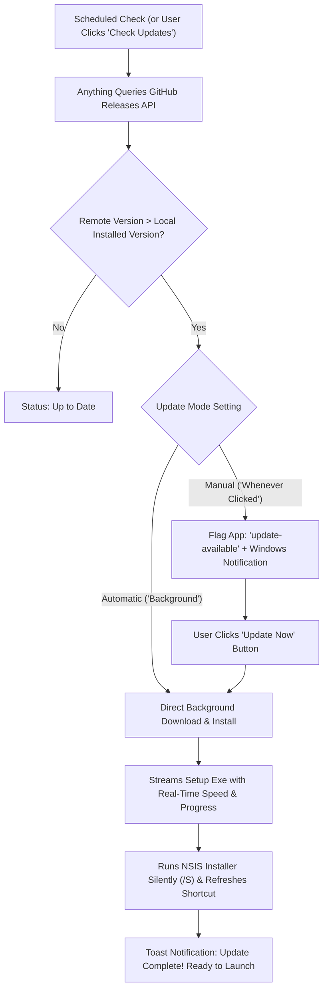

# 🚀 Anything Ecosystem: Auto-Update, GitHub Sync & Child App Lifecycle Guide

**Architect & Creator**: Burhanuddin Sounasath  
**Version**: 2.5 (Windows 11 / Liquid Glass Architecture)  
**Applicable For**: Anything Parent Hub & All Child Applications (e.g. One Tap, MediaFlow Studio)

---

## 📌 Executive Summary

The **Anything** ecosystem features an automated, zero-server child application distribution and update engine powered directly by **GitHub Releases** and local JSON registries.

Users and developers enjoy two distinct, fully configurable update experiences in **Settings → Auto-Update**:
1. **⚡ Automatic Updates (Background)**: Anything periodically queries GitHub Releases, detects newer versions, streams setup executables to disk, and executes silent installation without user disruption.
2. **🖱️ Manual / On-Demand ("Whenever User Clicks Update")**: Anything flags child apps with an **"Update Available"** badge and notifies the user; the installer only downloads and executes when the user explicitly clicks the "Update" button on the app card, in the app detail page, or in the Settings Update Manager.

---

## ⚙️ 1. Dual-Mode Update Engine (In Settings)

Users can configure their update preferences under **Settings → Auto-Update**:

### A. Update Modes
- **Mode 1: Automatic Updates (`auto`)**
  - Detects new GitHub releases automatically.
  - Automatically downloads and executes silent installation (`/S`) in the background.
  - Sequentially updates pending apps without NSIS mutex collisions.
  - Dispatches an Action Center notification when installation is complete and ready to launch.
- **Mode 2: Manual / On-Demand (`manual`)**
  - Queries GitHub Releases for newer semantic tags (`v<remote> > v<local>`).
  - Flags the app state with `'update-available'` and attaches release notes.
  - Displays prominent glowing **"Update Available"** buttons across the dashboard and child app pages.
  - The update process only starts when the user clicks **"Update Now"** or **"Update All Pending"**.

### B. Configurable Settings Parameters
- **Check Frequency**:
  - `Startup Only`: Runs a release check when Anything launches.
  - `Every 1 Hour`: Background recurring check every 60 minutes.
  - `Every 6 Hours`: Background check every 360 minutes.
  - `Manual Only`: Only checks when user clicks **"Check All for Updates"**.
- **Silent Background Installation Toggle**:
  - Enabled: Uses NSIS `/S` silent flags for seamless background updates.
  - Disabled: Launches the standard NSIS installer wizard so users can select custom installation directories.
- **Desktop Notifications Toggle**:
  - Alerts users when a new child app release is detected or when background installation completes.

### C. Live Child Applications Status & Update Dashboard
The Settings section renders a real-time table of all registered child applications (One Tap, MediaFlow Studio, etc.):
- **App Identity**: Icon, Product Name, and GitHub Repository link.
- **Installed Version**: Local version running on the PC.
- **Latest Remote Version**: Live version tag fetched from GitHub Releases.
- **Status Indicator**: Up to Date (green check), Update Available (amber pulse), or Updating (spinning loader).
- **Individual Update Trigger**: Immediate one-click update for a specific application.
- **Batch Master Actions**:
  - **"Check All for Updates"**: Queries GitHub API across all repositories simultaneously.
  - **"Update All Pending"**: Sequentially downloads and installs every pending update.

---

## 📂 2. The Zero-Touch Registry: `app-sources.json`

Instead of manually configuring endpoints, you only need to add your app's GitHub repository or release URL into **`app-sources.json`** located in the root of the Anything workspace:

```json
[
  {
    "url": "https://github.com/BSFrameWorks5253/onetap-workstation/releases",
    "name": "One Tap",
    "category": "Productivity & Utilities",
    "autoSync": true
  },
  {
    "url": "https://github.com/BSFrameWorks5253/MediaFlow-Studio",
    "name": "MediaFlow Studio",
    "category": "Media & Video",
    "autoSync": true
  }
]
```

### How Anything Automates This:
- **Live File Watcher**: Anything actively watches `app-sources.json`. Saving the file triggers automatic synchronization without app restart.
- **GitHub API Query**: Automatically contacts `https://api.github.com/repos/:owner/:repo/releases/latest`.
- **Auto-Generates Manifests**:
  - Creates `releases/<app-id>/v<version>/app.json` with identity, category, and styling.
  - Creates `releases/<app-id>/v<version>/release.json` with features and changelogs.
  - Creates `releases/<app-id>/loader-config.json` with default Liquid Glass parameters.
- **Immediate Catalog Listing**: The child app immediately appears on the Anything Apps Page with glass cards, search, demo trial, and one-click install/update.

---

## 🛠️ 3. What Must Be Done in the Child App

To make any new child app seamlessly integrate and auto-update through Anything, follow these 3 simple conventions:

### A. Binary Naming Standard
When building the app's Windows installer/executable, name the release asset:
- Setup Installer: `<AppName>_<version>_Setup.exe` (e.g. `OneTap_1.0.0_Setup.exe` or `Mediaflow_studio_6.0.0_Setup.exe`)
- Standalone Binary: `<AppName>_<version>.exe` (e.g. `OneTap_1.0.0.exe`)

### B. GitHub Release Tagging
Create releases using standard semantic tags:
- `v1.0.0`, `v1.0.1`, `v1.2.0`, etc.
- Attach the setup executable to the release assets.

### C. (Optional) Synchronized Splash Loader
When Anything launches your child app, it passes a command-line argument pointing to the live synchronized loader config:
```bash
YourApp.exe --loader-config="C:\Users\<user>\AppData\Roaming\Anything\loaders\<app-id>.json"
```

In your child app, you can read this JSON file on startup to render a splash screen that matches the exact visual theme, monogram, colors, and boot phrases configured in Anything!

---

## ⚡ 4. Automated Version-Wise Build & Release Publishing

To push your setup executable to GitHub Releases version-wise automatically after every build, use the built-in publishing engine:

### Option A: Set Your GitHub Personal Access Token (One-time)
Create a Personal Access Token with the `repo` scope on GitHub, then:
```powershell
# Set token for your current terminal session:
$env:GH_TOKEN="ghp_yourPersonalAccessTokenHere"

# Or save it in a .env file in the Anything root folder:
GH_TOKEN=ghp_yourPersonalAccessTokenHere
```

### Option B: Run the Release Script
```powershell
# 1. Publish Anything Setup Executable to GitHub Releases:
npm run release:github

# 2. Publish a specific Child App (e.g. One Tap):
node scripts/publish-github-release.cjs --app=one-tap

# 3. Publish Everything (Anything and all Child Apps):
npm run release:all
```

### What the Script Automatically Performs:
1. Reads `package.json` or `releases/<appId>/v<version>/app.json` to extract version, product name, and GitHub repo.
2. Locates the built setup executable (`OneTap_<version>_Setup.exe` or `Anything_<version>.exe`).
3. Checks if the release tag (`v<version>`) already exists on GitHub.
4. Generates formatted markdown release notes with highlights, features, improvements, and fixes.
5. Uploads the setup executable asset to GitHub Releases.
6. Returns the live release URL and direct download link.

---

## 🔄 5. How Auto-Update Operates on the User's PC



### Key Advantages:
1. **Zero Downtime / Silent Background Install**: Uses `/S` switch with NSIS installers for seamless upgrades.
2. **Collision-Proof Sequential Queue**: When multiple apps have updates in `auto` mode, Anything executes them in a clean sequential loop to prevent NSIS installer mutex conflicts.
3. **Action Center Notifications**: Windows 11 native interactive banner alerts users when updates are ready.
4. **1-Click Rollback**: Previous versions remain accessible in the **Version History** tab. Users can revert to older versions with one click.

---

## 🎨 6. Real-Time Loader Customization

The Anything ecosystem allows instant customization of splash screen loaders for both Anything and all child apps on a **live, real-time basis**:

1. Navigate to **Settings → Splash Screen Loader**.
2. Select **Anything** or any child app (e.g. **One Tap**, **MediaFlow Studio**).
3. Customize:
   - **Artwork Preset & Custom Image**: Upload any 1:1 image or select curated Apple Ambient and Dark Obsidian presets.
   - **App Monogram & Insignia**: Customize the vector monogram (e.g. `OT`, `Mf`, `An`).
   - **Boot Phrases**: Edit startup status text (e.g. *"Synchronizing One Tap shortcuts pipeline..."*).
   - **Glow & Accent Colors**: Tailwind gradients with specular reflection.
4. **Instant Synchronization**:
   - Settings are immediately saved to `releases/<appId>/loader-config.json` and `%APPDATA%/Anything/loaders/<appId>.json`.
   - Main process broadcasts `loader:updated` across all Electron windows in real time.
   - Any open splash screens or preview modals update with **zero latency**.

---

## ⚡ 7. Adobe Creative Cloud Style "Try / Demo" System

Like Adobe Creative Cloud, Anything allows users to **Try or Demo** any child application before committing to downloading or installing the full package.

### Key Capabilities:
1. **Interactive Demo Simulator**:
   - Users can click **"Try"** directly on any child app card or detail page.
   - An interactive sandbox simulator boots instantly inside Anything.
   - Users can test live features (hotkeys, multi-camera switching, audio visualizer, GPU hardware acceleration, timeline exports).
2. **Local Binary Demo Launch**:
   - If a standalone child app `.exe` is available, Anything invokes it detached in trial mode:
     ```bash
     AppName.exe --demo --trial --loader-config="path/to/loader-config.json"
     ```
3. **Instant Upgrade to Full Installation**:
   - Users can test without time limits or restrictions.
   - When satisfied, users click **"Install Full Version"** with 1 click to get permanent shortcuts and automatic updates.

---

## 📋 8. Summary Integration Flow

| Step | Action | Destination |
| :--- | :--- | :--- |
| **1. Register** | Add repo URL | [`app-sources.json`](file:///c:/Users/Burhanuddin/OneDrive/Desktop/New%20folder%20(2)/Anything/app-sources.json) |
| **2. Build** | Build child app setup executable | `releases/<app-id>/v<version>/<AppName>_<version>_Setup.exe` |
| **3. Publish** | Push version-wise release to GitHub | `npm run release:github` or `node scripts/publish-github-release.cjs` |
| **4. Customize** | Tune live splash loader | **Settings → Splash Screen Loader** |
| **5. Try / Demo** | Evaluate child app before installing | **"Try" button on App Card & Detail View** |
| **6. Update Mode** | Choose Auto-Update or On-Demand Click | **Settings → Auto-Update** |
