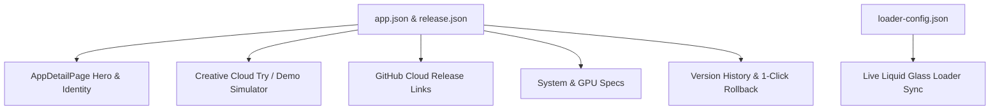

# 🎨 Child App Feature Page Optimization Guide

**Architect & Author**: Burhanuddin Sounasath (8369811201)  
**Target Platform**: Anything Parent App (Windows 11 / Apple WWDC26 Liquid Glass Architecture)  
**Audience**: Child Application Creators, Developers, and Maintainers  

---

## 📌 1. Overview & Purpose

The **Child App Feature Page** (`AppDetailPage.tsx`) in Anything is the primary storefront, installation manager, trial evaluation hub, and lifecycle control center for every child application (e.g. **MediaFlow Studio**).

This guide details how the page is constructed, how each section reads data from your app's configuration files, and **how child app developers can optimize their metadata, media assets, interactive demo hooks, and changelogs** to ensure maximum visual impact, 1-click conversion, and zero user friction.



---

## 💎 2. Anatomy of the Feature Page

The Feature Page is organized into 4 major zones:

| Zone | Component | Purpose | Data Source |
| :--- | :--- | :--- | :--- |
| **Zone 1: Action Header & Breadcrumb** | `AppDetailHeader` | Back navigation, quick Install, Try Demo, Update, Uninstall buttons | `app.status`, `app.installedPath` |
| **Zone 2: 3D Hero Spotlight** | `GlassCard` (Interactive) | High-res 3D icon, title, category, ambient glow, locate path button | `app.glowColor`, `logo.png`, `app.json` |
| **Zone 3: Creative Cloud Demo & Trial** | `AppDemoModal` & Spotlight Card | Interactive sandbox simulator, 7-day trial activation, local binary launch | `app.status: 'trial'`, `trialInfo` |
| **Zone 4: Tabbed Content Deck** | 4 Modular Tabs | Overview & Path, System Specs, Changelogs, Rollback Versions | `app.json`, `release.json`, `releases/` |

---

## 🚀 3. How to Optimize Each Section

### A. App Icon & Visual Identity (Hero Section)

To ensure your child app looks like a first-class Apple/Adobe tier product:

1. **Provide High-Resolution Logos**:
   - Save your logo as `logo.png` or `app-logo.png` inside `releases/<app-id>/v<version>/`.
   - **Recommended size**: `512x512` or `1024x1024` pixels PNG with transparency.
   - If not found, Anything falls back to a 3D specular liquid glass monogram using `app.shortName` and `app.gradient`.
2. **Configure Tailwind Gradients and Specular Glow**:
   In `app.json`:
   ```json
   {
     "gradient": "from-cyan-500 via-blue-600 to-indigo-700",
     "glowColor": "rgba(56, 189, 248, 0.45)",
     "textColor": "#38bdf8"
   }
   ```
   *Tip: Use vibrant, complementary HSL colors that illuminate against the deep dark background (`#090d16`).*

---

### B. Adobe Creative Cloud Style "Try / Demo" Optimization

Anything provides an interactive simulator and local trial executor for prospective users before they commit to downloading a full setup installer.

#### 1. Configuring Standalone Trial Executable
Provide both a full installer and a standalone trial executable in your release folder:
- Full Setup Installer: `Mediaflow_studio_6.0.0_Setup.exe`
- Standalone Trial Binary: `Mediaflow_studio_6.0.0.exe`

When the user clicks **"Run Local Demo"**, Anything spawns the binary detached with:
```bash
<AppName>.exe --demo --trial --loader-config="path/to/loader-config.json"
```

#### 2. Child App Command-Line Handling:
Your child app can detect trial mode in its main entry point:
```ts
// Child App main.ts / index.js
const isDemoMode = process.argv.includes('--demo');
const isTrial = process.argv.includes('--trial');

if (isTrial) {
  console.log('Running in 7-Day Creative Cloud Trial mode with full feature evaluation.');
}
```

#### 3. Interactive Sandbox Simulator Hook:
For multimedia apps, Anything automatically embeds an interactive 4K multi-camera switcher, waveform visualizer, and hardware acceleration engine inside the `AppDemoModal`.

---

### C. Repository Cloud Release Integration (GitHub)

The Feature Page includes a dedicated **Repository Release Source** card that fetches release packages directly from GitHub Cloud:

In `app.json`, declare:
```json
{
  "githubRepo": "BSFrameWorks5253/MediaFlow-Studio",
  "releasesUrl": "https://github.com/BSFrameWorks5253/MediaFlow-Studio/releases",
  "packageFileName": "Mediaflow_studio_6.0.0_Setup.exe"
}
```

#### What Anything Automatically Optimizes:
- **Direct Asset Download Link**: Formats direct CDN link `https://github.com/:repo/releases/download/v:version/:assetName`.
- **1-Click Copy Buttons**: Users can copy the repository release URL or direct setup asset link with instant clipboard feedback.
- **External Web Launcher**: Opens release pages in the default system browser via `electronAPI.openExternal()`.

---

### D. System & Hardware Specifications Tab

Under the **Hardware & System Specs** tab, users see whether their PC is capable of running the child app smoothly.

In `app.json`, specify both **Minimum** and **Recommended** specifications:
```json
"systemRequirements": {
  "os": "Windows 11 / Windows 10 (64-bit 22H2+)",
  "processor": "Intel Core i7 12th Gen / AMD Ryzen 7 5800X or higher",
  "ram": "16 GB DDR4/DDR5 (32 GB recommended for 4K multicam)",
  "graphics": "NVIDIA GeForce RTX 3060 / AMD Radeon RX 6700 XT with 8GB VRAM",
  "storage": "2.5 GB NVMe SSD available space",
  "display": "1920x1080 resolution or higher (4K UHD recommended)"
}
```

Anything renders these with clean specular icons (`Cpu`, `Monitor`, `HardDrive`, `ShieldCheck`), giving users clear confirmation before installation.

---

### E. Release Notes, Changelog & Email Previews

In `releases/<app-id>/v<version>/release.json`, structure rich changelogs:
```json
{
  "version": "6.0.0",
  "releaseDate": "2026-10-23",
  "title": "Major Release: Liquid Glass Architecture & Auto-Update Engine",
  "highlights": [
    "Apple WWDC26 Liquid Glass dynamic window styling",
    "Creative Cloud style Try / Demo mode with 7-day trial",
    "Real-time Splash Screen Loader synchronization with Anything"
  ],
  "features": [
    { "name": "DirectX 12 GPU Acceleration", "description": "Zero-latency 4K multi-stream ingestion" },
    { "name": "Live Event Bus", "description": "0.36ms inter-process communication with Anything parent" }
  ],
  "fixes": [
    "Resolved taskbar icon disparity in background workers",
    "Fixed executable resolution for silent NSIS background updates"
  ]
}
```

#### Why this is important:
- Anything renders these in the **Changelog & Updates** tab with color-coded badges (`Feature`, `Fix`, `Performance`).
- Users can preview what's new before updating or rolling back.

---

### F. Multi-Version History & 1-Click Rollback

Child apps with multiple published releases in `releases/<app-id>/` automatically populate the **Other Versions & Rollback** tab.
- Users can see all past builds (e.g. `v5.2.0`, `v5.1.0`, `v6.0.0`).
- Each version lists file size, tag link, and a **"Rollback to this Version"** button.
- Rollback downloads the previous setup package, updates local state, and restores the previous binary cleanly.

---

## 📋 4. Developer Optimization Checklist

Before publishing a child app release, verify this checklist:

- [ ] **Identity & Naming**:
  - `id` matches `[a-z0-9-]+` (e.g. `mediaflow-studio`).
  - `name` is properly capitalized (e.g. `MediaFlow Studio`).
  - `executableName` matches actual binary name (e.g. `Mediaflow_studio_6.0.0.exe`).
- [ ] **Branding & Logos**:
  - `logo.png` (512x512 PNG, transparent background) placed in version directory.
  - Specular gradient and `glowColor` set in `app.json`.
- [ ] **Creative Cloud Try / Demo Support**:
  - Standalone executable supports `--demo` and `--trial` command-line flags.
  - In `app.json`, category is accurate (`Media & Video`, `Development`, `Productivity`, `Design`).
- [ ] **GitHub Releases Integration**:
  - `githubRepo` matches `owner/repo`.
  - Repository URL added to [`app-sources.json`](file:///c:/Users/Burhanuddin/OneDrive/Desktop/New%20folder%20(2)/Anything/app-sources.json).
  - Version tag formatted as `v<semantic-version>` (e.g. `v6.0.0`).
- [ ] **Hardware Specs & Changelog**:
  - `systemRequirements` defined with realistic CPU, RAM, and GPU requirements.
  - `release.json` includes `highlights`, `features`, and `fixes`.
- [ ] **Splash Loader Sync**:
  - Default `loader-config.json` generated in `releases/<app-id>/`.

---

## 🔗 Related Documents

* [Child App Integration Specification (`CHILD_APP_INTEGRATION_GUIDE.md`)](file:///c:/Users/Burhanuddin/OneDrive/Desktop/New%20folder%20(2)/Anything/DOCS/CHILD_APP_INTEGRATION_GUIDE.md)
* [Auto-Update & Child App Lifecycle Guide (`AUTO_UPDATE_AND_CHILD_APP_LIFECYCLE.md`)](file:///c:/Users/Burhanuddin/OneDrive/Desktop/New%20folder%20(2)/Anything/DOCS/AUTO_UPDATE_AND_CHILD_APP_LIFECYCLE.md)
* [Zero-Touch App Registry (`app-sources.json`)](file:///c:/Users/Burhanuddin/OneDrive/Desktop/New%20folder%20(2)/Anything/app-sources.json)
* [Master Documentation Index (`DOCS/INDEX.md`)](file:///c:/Users/Burhanuddin/OneDrive/Desktop/New%20folder%20(2)/Anything/DOCS/INDEX.md)
